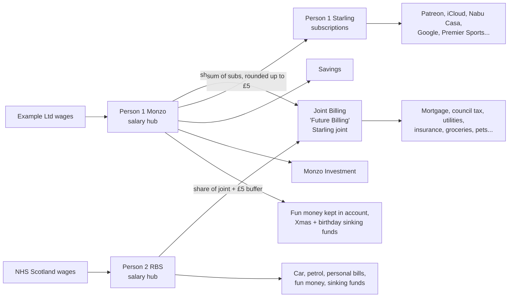

# A Wee Bawbee — Build Plan (v3)

*Our household finance app. The name comes from the Scottish nursery rhyme "Coulter's Candy" (also known as "Ally Bally Bee"), in which a bairn is greetin' for a wee bawbee, an old Scots halfpenny.*

**Naming conventions**

| Where | Name |
|---|---|
| Display name | A Wee Bawbee |
| Short name (PWA, mobile nav, browser tab) | Bawbee |
| Repo | `a-wee-bawbee` |
| Python package and Docker services | `bawbee` (`bawbee-app`, `bawbee-worker`) |
| Hostname | e.g. `bawbee.<my-domain>` |

> **For Claude Code:** Read this whole file before writing any code. Then create a `CLAUDE.md` that summarises the conventions in §12–§13, and start at **Phase 0** in §14. Work one phase at a time, stop at the end of each phase, and show me the acceptance checks passing before moving on. `seed/budget-seed.json` contains an example budget in the spreadsheet's format (made-up figures), plus the numbers the app's engine produces for it. Use it for seeding and golden tests. §2 records decisions I've already made; don't re-ask them, and raise anything that contradicts them.

> **For Person 1:** All open questions are answered (§15). Before Phase 6, copy your childcare calculator zip and its `state.json` into `reference/childcare-app/`. `seed/` and `reference/` are committed so CI and Codespaces can run the golden tests. In this copy they hold made-up example data only.

---

## 1. Background and goals

Person 2 and I (Person 1) run our household money from an Excel workbook. No app I've tried models how we actually do it. Each of us is paid into our own account, and we each move a calculated share into a joint bills account. I run a separate account just for my subscriptions. We also keep alternative versions of the whole budget for different stages of life.

The app should:

1. Replace the two sheets I actually use, **Standard Finances** (standard budget) and **Maternity Finances** (a what-if), with a proper data model. Future budget versions must stay in sync with the live budget instead of drifting apart as copy-pasted sheets.
2. Let us **plan ahead** with what-if versions of the budget, forecast 2–3 years, and promote a what-if to live when that stage of life arrives.
3. Tell each of us exactly what to transfer on payday, and calculate the joint contribution automatically.
4. Pull transactions from all our bank accounts (open banking, with CSV import as the fallback) so I stop typing bills in by hand. Flag price changes and new recurring payments for me to approve.
5. Absorb my existing **childcare calculator** (nursery options, work patterns, tax, Tax-Free Childcare) and feed its results into budget versions.
6. Track the mortgage (Northfield, 5-year fix), including balance, fix end date and remortgage window.
7. Look hand-crafted, not AI-generated, and work well on laptop and mobile browsers.
8. Run self-hosted on my home VMs with Docker Compose.

Non-goals: payment initiation (read-only only), multi-household SaaS, investment portfolio tracking, tax returns.

---

## 2. Decisions already made

| # | Topic | Decision |
|---|---|---|
| 1 | Version relationship | A what-if stores **only its differences** from its base. Everything else stays in sync. |
| 2 | Changes to live | Live changes flow into what-ifs automatically **unless** the what-if has overridden that line. |
| 3 | How versions fit together | What-ifs are **standalone**. When the time comes, I **promote** one to live. Promotion takes the current live budget (with all updated bills) and applies only what the what-if specifically changed. A what-if may carry an *optional* planned start date, used only for the forecast timeline and a reminder. |
| 4 | Dated steps inside a version | **Not needed.** A version's amounts are constant. Use another what-if for the next stage. |
| 5 | Forecast horizon | **2–3 years** (default 36 months). |
| 6 | One-offs | **Both** dated one-off items **and** savings goals (target amount + date → monthly amount). |
| 7 | Forecast output | **Both** monthly surplus/shortfall **and** projected account balances. |
| 8 | Income | Calculate take-home from gross (Scottish tax, NI, pension, salary sacrifice), **with manual override**. |
| 9 | Maternity pay | **No special modelling.** Enter amounts in the what-if. |
| 10 | Childcare | **Fully incorporate my childcare calculator** into the app, feeding its results into versions. |
| 11 | Planned start arrives | **Prompt me to confirm** before promoting. Never switch automatically. |
| 12 | Period ends | Keep it **read-only with planned vs actual** from bank data. |
| 13 | Comparing | **Timeline chart** of surplus and balances across versions, **plus a side-by-side table**. |
| 14 | Joint split basis | **Set per version** (gross / take-home / surplus / fixed %). |
| 15 | Rounding | Keep **round up to nearest £5 + £5 buffer**. |
| 16 | Apple Fitness+ in joint | **A mistake.** It belongs only on Person 1 Starling. Remove it from Joint after parity tests. |
| 17 | Pink highlights | **Follow-up flags**: things to cancel, check the current price of, or check which account they should be on. |
| 18 | Accounts to sync | **All**, including Person 2's RBS. Person 2 links their own accounts themselves. |
| 19 | Detected price change | Goes to an **inbox for approval**. On approval, ask whether what-ifs that override that line should update too. |
| 20 | Users | **Both of us, separate logins**, both full access, with an audit trail of who changed what. |
| 21 | Joint "Future Billing" account | **Starling joint account**, held by both of us. Connect it once only. |
| 22 | Live budget today | **Maternity is live.** Back to normal becomes the what-if "Back to normal". |
| 23 | Person 2's lines | **SOE** = Society of Engineers (professional membership). **Car** = PCP, ending around **Oct 2027**. |
| 24 | Mortgage | Fix ends **Nov 2027** (exact day TBC). Penalty-free overpayment **10% per year**. I'll enter the statement balance in the app. |
| 25 | Pay days | Person 1: **last working day** of the month. Person 2: officially the **last Thursday**, but usually arrives the **Wednesday before**. |
| 26 | Childcare reference | I'll add the **code and `state.json`** to `reference/childcare-app/`. |
| 27 | Login | **Local accounts (username + password) by default.** authentik OIDC is **optional**: off unless configured, and either method can be used once it's on (§12). |
| 28 | Back to normal prices | **"Back to normal" uses today's prices.** After import, its overrides for the §4.6 price changes are dropped, so those bills follow live. Its other differences stay. |
| 29 | Monzo | **Monzo is read through the Monzo Developer API**, because Enable Banking doesn't offer Monzo (found while setting up Phase 4). A confidential OAuth client, for personal use only. Enable Banking stays for RBS, and the Starling token stays for Starling (§8.1). |
| 30 | Plan reminders | **The remortgage window opens 7 months before the fix ends** (about April 2027), not 6. Every other renewal reminds **30 days** ahead. Goals propose a new monthly amount through the inbox; the take-home check compares the calculation with the salary that lands, with a typed-in payslip and an override as well. The Plan screens share one hub (Forecast, Compare, Childcare, Mortgage, Take-home, Renewals). |
| 31 | The look | **"Clear", Apple-native, replaces the banknote look.** Grouped white cards on a soft grey ground, the system font (San Francisco, Inter elsewhere), frosted glass header, and a floating iOS-style glass tab bar on phones. One blue accent, and accounts keep their own colours. Chosen from three prototypes (Clear, Paper, Night). `DESIGN.md` records it. |
| – | Look and feel | Use **Impeccable** (§11) so it doesn't look AI-generated. |
| – | Devices | **Laptop and mobile browsers**, mobile-first. |
| – | Hosting | **Docker Compose on my home VMs**, behind my existing nginx reverse proxy. authentik is optional (decision 27). |

---

## 3. How the spreadsheet works today

### 3.1 Accounts and money flow



The sheet also lists a **Person 1 RBS** account, but it's unused (£0).

### 3.2 Line types

Every row in the sheet is one of three things. The seed file labels each line with `kind`:

| kind | Meaning | Examples |
|---|---|---|
| `bill` | A recurring payment to a third party. Should be matchable to bank transactions. | Mortgage (Northfield), Sky, Octopus, Patreon |
| `allocation` | Money earmarked for something, but not one fixed payment | Groceries, Fun Money, Xmas Savings, Dogs, Petrol |
| `transfer` | Money moving between our own accounts | To Joint Billing, To Starling, To Savings |

Conventions in the sheet the app must preserve:

- **Labels** are written `Name (Provider)`, e.g. `Council Tax (Exampletown)`. The seed splits these into `name` and `provider`. The provider is a strong hint for matching bank transactions.
- **Day of month.** The column left of each label is the day the payment leaves. It's often blank.
- **Annual bills** are entered as `=annual/12` (FotMob £7.49, AdGuard £4.99, Ring £49.99). Model these as `frequency: annual` with the real annual amount and a renewal date, and show the monthly equivalent in budgets.
- **Composite bills** are entered as sums. Life & Income Protection is two Aviva policies (`=42.36+36.78`), and Pet Insurance is one policy per dog (`=65.12+73.62`). Model each as a bill with child components.
- **Follow-up flags.** A red `CANCEL!!` row and the pink highlights both mean "follow up". The seed converts them into `follow_ups` with a reason of `cancel`, `check` or `check_account`.
- **Category colours.** Conditional formatting colours rows containing "Loan", "Credit Card", "Insurance" and "Hire". Model these as categories.

### 3.3 The calculations

The seed's `expected_spreadsheet_outputs` holds every number below, and I've verified the seed data regenerates each one.

**Joint contribution (suggested):**

```
share_person_1 = basis_person_1 / (basis_person_1 + basis_person_2)
person_1_to_joint = ceil_to_£5(joint_total × share_person_1 + extra_lines_for_person_1) + £5
person_2_to_joint = ceil_to_£5(joint_total × share_person_2) + £5
```

- `joint_total` is the sum of the monthly equivalents of every Joint Billing line.
- **Split basis.** Standard uses gross salary (Person 1 £76,500 + £4,500 benefits allowance vs Person 2 £47,200). Maternity uses monthly take-home (£4,215.80 vs £1,523.75). Maternity also shows "share of surplus" as information only.
- `extra_lines_for_person_1` is Apple Fitness+. The sheet adds it on top of Person 1's share (`extra_lines_mode: on_top_of_share`). This is reproduced for parity only and then removed (decision 16).

**Starling top-up:** `ceil_to_£5(sum of Person 1 Starling monthly equivalents)`, with no buffer. Currently £135.

**Manual overrides:** In Maternity, the actual transfers are typed in (Person 1 £2,670, Person 2 £700) next to the suggested figures (£2,445 / £885). The app must store both *suggested* and *actual* and show the difference.

**Surpluses:**

- **Personal surplus** = take-home − everything leaving that person's hub account.
- **Joint surplus** = transfers in − joint total.
- **Household surplus** = the sum of all three.

| | Standard | Maternity |
|---|---|---|
| Joint total out | £3,221.65 | £3,307.50 |
| Person 1 → Joint | £2,055 | £2,445 suggested / **£2,670 actual** |
| Person 2 → Joint | £1,195 | £885 suggested / **£700 actual** |
| Person 1 → Starling | £135 | £135 |
| Person 1 surplus | £372.45 | £510.80 |
| Person 2 surplus | £416.45 | **−£130.05** |
| Joint surplus | £28.35 | £62.50 |
| Household surplus | £817.25 | £443.25 (sheet shows £155.75, see §4) |

---

## 4. Problems in the current spreadsheet

The app should make each of these impossible or visible. Each one is also a test case.

1. **Maternity surplus split is wrong.** `P14` is a hard-coded £4,002.38, but the real combined surplus is £3,750.75. The two percentages therefore add to 93.7%, and the joint account would be under-funded by about £210/month under that method. Derived values must never be hard-coded.
2. **Household surplus is inconsistent.** Standard includes the joint surplus in the total but Maternity leaves it out. The app uses one definition everywhere.
3. **Scenarios have drifted.** Maternity is a copy of Standard with independent edits, which decision 1 fixes.
4. **Stale reference data.** Salaries are labelled Nov 2022, and the mortgage payment is £1,192.46 in the budget but £1,193.80 in Mortgage Info. Every input needs an "as of" date, and the app should nudge me when key inputs are over 12 months old.
5. **Apple Fitness+ appears twice.** It's on both Person 1 Starling and Joint Billing. Fix it in a post-import cleanup.
6. **Price changes go unnoticed.** Comparing the two sheets shows real changes that nobody was alerted to:
   - Pet insurance: £96.55 → £138.74 (+72%)
   - Sky: £98 → £104.75
   - Council tax: £243.50 → £259.80
   - Spotify: £16.99 → £17.99
   - Car insurance: £39.12 → £41.27
   - Broadband: £49 → £26.12
7. **Thin buffers.** The joint surplus is only £28–£63/month. Show the projected joint balance across the month by bill day, and warn if it would go negative before payday.

---

## 5. Budget versions: the core concept

This is the most important part of the design. Get it right in Phase 1 before building UI.

### 5.1 Terms

- **Live budget.** Exactly one at any time. It's what payday, bank matching and alerts use.
- **What-if.** A named version holding only overrides against a base. Its base is the live budget by default, but can be another what-if, so versions can chain. For example, "Second child" could be based on "Back to work 3 days". Each what-if has:
  - a name and description
  - an optional planned start date
  - its own settings: split basis, rounding/buffer, income overrides, childcare scenario link
  - its own one-off items and savings goals
- **Override.** A sparse change in a what-if: modify a line's fields, remove a line, or add a new line. Each override records the base line version it was made against (`based_on_version_id`), so conflicts can be detected later.
- **Period.** A frozen, read-only record of a live budget from the date it was promoted to the date it was replaced. It shows planned vs actual using matched bank transactions.
- **Forecast path.** A named, ordered sequence: live budget now, then what-if X from date A, then what-if Y from date B. The path drives the 36-month forecast. I can save several paths, e.g. "Return 3 days" vs "Return 4 days", and compare them on the timeline chart.

### 5.2 Resolution

```
resolve(version) =
  if version is live: live lines (latest line versions)
  else: apply(version.overrides, resolve(version.base))
```

Settings resolve the same way: a what-if inherits its base's split basis unless it sets its own.

### 5.3 Inheritance behaviour (decision 2)

- When a live line changes (manually or via an approved price change), every what-if that does not override that line sees the new value immediately. No action is needed.
- What-ifs that **do** override the changed line are listed in the approval dialog with three choices:
  - keep my override
  - drop my override and take the new live value
  - edit the override
- If a what-if's override becomes identical to the base value, flag it as redundant and offer to remove it.

### 5.4 Promotion (decisions 3 and 11)

1. **Trigger.** I choose "Promote to live", or a what-if's planned start date arrives. In the second case, the app shows a prompt on the dashboard and sends a Home Assistant notification. It never auto-switches.
2. **Preview.** Show exactly what will change: each override as old live value → new value, plus lines added and removed. Show **conflicts** where the live line has changed since the override was made (`based_on_version_id` is no longer the latest), with a per-line choice of override or live.
3. **Effective date.** Choose it, defaulting to the next payday.
4. **Commit.** All in one transaction:
   - Freeze the current live budget as a **Period** (start date to the effective date).
   - Write the what-if's overrides into the live budget as new line versions effective from that date.
   - Mark the what-if as `promoted`.
   - Re-point any what-ifs based on it so they're based on live.
5. **Undo.** Promotion is undoable until the first payday run under the new live budget.

### 5.5 Forecast (decisions 5, 6, 7)

- Monthly granularity for 36 months. The current month also gets a day-by-day joint balance projection using bill days and pay days.
- **Inputs:**
  - the resolved version for each month of the chosen forecast path
  - one-off items (dated, signed amounts, assigned to an account)
  - savings goals: target, date and account, generating a monthly allocation line of remaining ÷ months left, recalculated as balances change
  - opening balances from bank sync, or entered manually
- **Outputs:**
  - per-month personal, joint and household surplus
  - projected balance of each account
  - warnings for any month where an account goes negative or a goal falls behind
- **Agreements with end dates.** Some bills end on a known date, like Person 2's car PCP (around Oct 2027). These carry an `agreement` with an end date, and the forecast stops them after that date. This is the second deliberate exception to decision 4, because the end date is a fact of the contract rather than a planned step. Three months before the end, raise an inbox item offering:
  - "Create what-if" for a new car, or for keeping this one
  - a dated one-off for the optional final (balloon) payment
- Amounts are otherwise constant within a version (decision 4). Anything that changes at a date, like the mortgage fix ending, is modelled as another what-if on the path. The mortgage module (§10) can create a "Remortgage at X%" what-if for this.

### 5.6 Autumn 2027 cluster

Several things change at about the same time, and the dashboard timeline should make this obvious:

| When | What |
|---|---|
| ~Apr 2027 | Remortgage window opens (7 months before the fix ends, decision 30) |
| ~Oct 2027 | Car PCP ends |
| Nov 2027 | Northfield fix ends |

Use this as an acceptance test for the forecast: a path with "Remortgage at X%" from Nov 2027 shows both changes, and the inbox raises the PCP and remortgage items on time.

### 5.7 Pay-day rules

- **Person 1:** last working day of the month, using Scottish bank holidays.
- **Person 2:** officially the last Thursday of the month, but usually arrives the Wednesday before. Model this as `last_thursday` with `typical_offset_days: -1`, and update the offset from actual bank data.
- **Uses:**
  - the current-month day-by-day joint balance projection
  - the Payday checklist ("transfers due after both salaries land")
  - an inbox item if a salary hasn't arrived by the expected day + 1

### 5.8 Comparing (decision 13)

- **Timeline chart.** Household surplus and selected account balances over 36 months, one line per forecast path, with markers where a version changes.
- **Side-by-side table.** Two to four versions, every line grouped by account, with differences highlighted. It also shows each version's transfers, surpluses, and the joint split under every basis, so the fairest option is easy to see.

---

## 6. Domain model

Store money as **integer pence** everywhere: database, API and engine. Never use floats. Format only at the UI edge (`£1,192.46`). Dates are ISO dates and timestamps are UTC.

```
Person(id, name, user_id?)
User(id, username, display_name, person_id, email?,
     password_hash?,        -- Argon2id; null for an OIDC-only user
     oidc_subject?,         -- set when linked to an OIDC identity
     disabled_at?, last_login_at?)
AuthSession(id, user_id, created_at, expires_at, last_seen_at, ip?, user_agent?, method: local | oidc)

Account(id, name, owner: person_id | 'joint', provider, role:
        salary_hub | subscriptions | joint_bills | savings | investment | dormant,
        bank_connection_id?, external_account_id?, opening_balance_pence?, currency='GBP')

Category(id, name, colour, parent_id?)

BudgetLine(id, name, provider?, kind: bill | allocation | transfer,
           account_id, to_account_id?, category_id, owner, tags[],
           status: active | cancelled, linked_mortgage_product_id?,
           agreement_json?)  -- e.g. {type: PCP, end_date, end_date_confirmed, balloon_payment_pence}
BudgetLineVersion(id, line_id, effective_from, effective_to?,
           amount_pence?, frequency: monthly | annual | quarterly | weekly,
           day_of_month?, renewal_date?, transfer_rule_json?, components[],
           created_by, created_at)

FollowUp(id, line_id?, transaction_id?, reason: cancel | check_price | check_account | check | other,
         note, status: open | done | dismissed, created_by, due_date?)

BudgetVersion(id, name, type: live | what_if | period, base_version_id?,
         planned_start?, period_start?, period_end?, status: draft | promoted | archived,
         settings_json  -- split_basis, fixed_pct_person_1, rounding_step_pence=500, buffer_pence=500
         childcare_scenario_id?)
Override(id, version_id, line_id?, action: modify | remove | add,
         fields_json, based_on_version_id?, created_by, created_at)
OneOff(id, version_id, date, account_id, amount_pence, description, category_id)
SavingsGoal(id, version_id, name, target_pence, target_date, account_id, start_balance_pence?)
ForecastPath(id, name, steps: [{version_id, from_date}])

IncomeSource(id, person_id, employer, as_of_date,
         gross_annual_pence, benefits_allowance_pence?, bonus_pence?,
         salary_sacrifice_pence?, pension_scheme: nhs_scotland | workplace_pct | none,
         pension_pct?, student_loan_plan?, tax_code?, hours_per_week?, fte?)
IncomeVersion(id, income_source_id, version_id?, net_monthly_override_pence?,
         gross_override_pence?)   -- per-version overrides
PayDayRule(id, person_id, rule: last_working_day | last_thursday | fixed_day | ...,
         fixed_day?, typical_offset_days=0, calendar='scotland', learned_from_bank=true)

TaxYearConfig(tax_year, region: scotland | rUK, bands_json, ni_json,
         personal_allowance_json, child_benefit_json, hicbc_json, source_urls[], verified_at)

ChildcareScenario(...)   -- see §9

PaydayRun(id, month, version_id, created_at)
PaydayTransfer(id, run_id, from_account_id, to_account_id,
         suggested_pence, actual_pence, done_at?, done_by?, matched_transaction_id?)

BankConnection(id, owner_user_id, provider: enable_banking | starling_pat | monzo | csv,
         session_ref (encrypted), consent_expires_at, status, last_sync_at)
Transaction(id, account_id, external_id, booked_date, value_date, status: pending | booked,
         amount_pence, description, counterparty, merchant_normalised,
         category_id?, matched_line_id?, raw_json)
CategoryRule(id, priority, match_json, set_category_id?, set_line_id?)
RecurringCandidate(id, account_id, merchant_normalised, cadence, typical_amount_pence,
         last_seen, confidence, status: new | accepted | ignored)
InboxItem(id, type: price_change | new_recurring | missed_payment | consent_expiring |
         promotion_due | redundant_override | stale_input | remortgage_window,
         payload_json, status: open | approved | rejected | snoozed, resolved_by?, resolved_at?)

Mortgage(id, lender, property_value_pence, value_as_of)
MortgageProduct(id, mortgage_id, rate, type: fixed | tracker | svr, start_date, end_date,
         monthly_payment_pence, term_months, overpayment_allowance_pct?, erc_notes)
MortgageStatement(id, mortgage_id, date, balance_pence)

AuditLog(id, user_id, entity, entity_id, action, before_json, after_json, at)
```

---

## 7. Calculation engine

Write the engine as a pure, side-effect-free package, with no database or framework imports.

```
calculate(resolved_version, incomes, as_of) -> MonthResult {
  per_account, joint_total_pence, shares (exact Fractions),
  transfers [{from, to, suggested_pence, actual_pence, rule}],
  surpluses {person_1, person_2, joint, household}, warnings[]
}
forecast(path, one_offs, goals, opening_balances, start_month, months=36) -> [MonthResult + balances]
take_home(income_source, tax_year_config, overrides) -> breakdown (gross, tax, NI, pension, sacrifice, net)
childcare(scenario, tax_year_config) -> see §9
```

Rules:

- **Annual items.** The monthly equivalent is `amount / 12`. Keep fractional pence internally, and only round where the spreadsheet does (the £5 ceilings).
- **Ceilings.** `ceil_to_step` must be exact for exact multiples. Use integers or Fractions, never floats.
- **Surplus basis.** The `surplus` split basis computes both personal surpluses from live data (fixes §4.1).
- **Household surplus** always includes the joint surplus (fixes §4.2).
- **Tax rates** come only from `TaxYearConfig` data files, never constants in code. Each file cites its gov.uk / gov.scot source. Include 2026/27 Scottish bands and verify them against official sources. Provide a "check against payslip" screen: I enter a payslip's gross and net, and the app shows the difference. Last time, the effective higher-rate threshold had to be back-solved from a real payslip.

**Golden tests (Phase 1):**

- Load `seed/budget-seed.json` *before* the post-import cleanups. Assert every value in `expected_spreadsheet_outputs` to the penny.
- Apply the cleanups and assert that Apple Fitness+ is gone from Joint and that both joint transfers drop accordingly.
- Add a test for each issue in §4.

---

## 8. Bank sync (open banking)

### 8.1 What's realistic for a personal app in the UK (checked October 2026; re-verify)

| Route | Status | Notes |
|---|---|---|
| GoCardless Bank Account Data | **Unavailable**: no new accounts since July 2025 | Ignore older self-hosted guides that assume it. |
| **Enable Banking** | **Primary.** Free restricted production mode for your own linked accounts, for non-commercial use | Register a production app, then link accounts to activate it. Only linked accounts are returned. Needs an HTTPS redirect URL. Actual Budget and Firefly III both integrate it. |
| Starling Personal Access Token | **Primary for Starling.** Covers two accounts: Person 1 Starling and the **joint billing account** | Read scopes only. Supports webhooks for near-real-time updates. Confirm the PAT can see the joint account. If it can't, use Enable Banking for it. |
| **Monzo Developer API** | **Primary for Monzo** (decision 29): Enable Banking turned out not to offer Monzo | Personal use only, through a confidential OAuth client. Access must be approved in the Monzo app; full history only for five minutes after that, then 90 days. Tokens last about six hours and refresh (each refresh replaces both). Monzo Investment isn't covered: CSV or a manual balance. |
| **CSV import** | **Build first** | Every bank exports CSV. It's also the fallback whenever a consent lapses. |

**Confirm before Phase 4:**

- RBS and Starling personal accounts appear under GB in the Enable Banking control panel. (Monzo didn't, hence decision 29.)
- How long a UK session lasts (`valid_until`).
- Person 2 linking their own accounts fits the restricted-mode terms.
- Whether the redirect URL can be an internal HTTPS hostname. The redirect happens in the browser, so it probably doesn't need to be internet-reachable. Test this in the sandbox.

### 8.2 Limits to design around

- **No bill list.** Open banking gives balances and booked/pending transactions. It does not reliably give upcoming direct debits, the Northfield mortgage balance, pensions or investments. Bills are **inferred** from transactions and confirmed by me.
- **Consents expire.** Track expiry per connection, raise an inbox item 14 days before, and offer one-click re-link. The person who owns the connection does the re-link, so Person 2 re-links their own.
- **Rate limits.** Banks limit unattended syncs to a few per day. Sync 2–4 times a day per account at most.
- **Joint account appears twice.** Both of us hold the Starling joint account, so it could show up through both our connections. Connect it once, under Person 1. If it shows up again, recognise it by its account identifiers and don't import it twice.

### 8.3 Design

```
providers/
  base.py           # start_link(), complete_link(code), list_accounts(),
                    # fetch_transactions(since), fetch_balances()
  enable_banking.py # JWT RS256 signed with the app private key, kid = application id
  starling_pat.py
  monzo.py          # Monzo Developer API: OAuth, approve-in-app, rotating refresh tokens
  csv_import.py     # Monzo / Starling / RBS mappings + generic column mapper
```

- **Enable Banking flow:**
  1. `POST /auth` with the bank, country `GB`, redirect URL and `valid_until`.
  2. The user authenticates at their bank.
  3. The callback returns a `code`.
  4. `POST /sessions` returns the session and accounts.
  5. Fetch data with `GET /accounts/{id}/transactions` (paginate with `continuation_key`) and `GET /accounts/{id}/balances`.

  Verify the endpoints against current docs, and develop against the **sandbox** first.
- **Private key.** The `.pem` file is a Docker secret and is never committed.
- **Idempotent ingestion.**
  - Deduplicate on `(account_id, external_id)`, falling back to a hash of date, amount and description.
  - When a pending transaction becomes booked, update it in place.
  - **History from before the budget (decided in Phase 5).** Bank history can be older than the live budget's first line versions (the seed import date). Those months are matched against the budget as it first stood, and no price changes are raised for them; recurring detection records any price step it sees there.
  - **CSV hand-over (decided in Phase 4).** When an account with CSV imports is linked, the bank takes over from the day after its last CSV row. CSV rows for days the bank has covered are skipped from then on. No fuzzy matching between the two sources.
- **Scheduler.** Sync at 06:00 and 18:00, plus a manual "sync now".
- **Salary detection.** Recognise salary credits by employer name and amount. Record the **actual** pay date each month, and use it to refine the pay-day rules (§5.7).
- **Internal transfers.** Match equal-and-opposite amounts between our own accounts within ±2 days. Link them to `PaydayTransfer` rows so the payday checklist ticks itself.

### 8.4 Transactions → bills and the approval inbox (decision 19)

1. **Normalise merchants** using a user-editable alias table.
2. **Detect recurring payments.** A merchant counts as recurring with ≥3 occurrences per account on a consistent cadence (monthly ±3 days, annual ±7 days, weekly) and an amount that's stable or within ±15%.
3. **Match to budget lines** by provider name (from `Name (Provider)`), account, amount and day.
4. **Inbox items. Nothing changes the budget without approval.**
   - **Price change:** a matched bill differs from its budget amount. On approval, write a new `BudgetLineVersion` from the date seen. Then list any what-ifs overriding that line, with keep / drop / edit for each (§5.3).
   - **New recurring payment:** add it to the live budget (choose kind, category and account) or ignore it.
   - **Missed payment:** a bill hasn't appeared by its day + 5.
   - **Follow-up still paying:** a `cancel` follow-up whose bill is still being taken.
5. **Actual vs planned** monthly view per line and category, especially for allocations like Groceries.

---

## 9. Childcare module (decision 10)

This incorporates my existing self-hosted childcare calculator. Port its behaviour exactly first, then improve it. The reference code goes in `reference/childcare-app/`, and its saved `state.json` should import directly.

Behaviour to preserve:

- **Work patterns.** Pay is driven by **hours**, and nursery cost is driven by **days**. Keep these separate: an earlier version wrongly made a 5-day week pay more than a 4-day week with the same 36 hours.
- **Nurseries.** Multiple nurseries, each with:
  - day or hourly rates, per child
  - sibling and other discounts (flag any as unconfirmed)
  - minimum-days thresholds
  - a toggle for whether it accepts Tax-Free Childcare
  - a toggle for whether it bills for leave days when the child doesn't attend
- **Leave.** Entered in **days** (Person 2: 27.5) and pro-rated against a reference work pattern.
- **Tax.** Scottish income tax, NI, and NHS Scotland pension tiers based on **actual earnings, not whole-time equivalent**. At full pay the tier is 11.6%; it drops (e.g. to 10.5% or 7.0%) at reduced hours. Store tiers in config with the SPPA source.
- **Benefits.** Child Benefit, and the High Income Child Benefit Charge based on Person 1's taxable income after salary sacrifice (currently about £88k, which claws it back fully).
- **Funded hours by age.** Add this; it isn't in the old app yet. Keep the Scottish rules in config and verify them.
- **Views:**
  - a matrix of work pattern × nursery, switchable between left over, childcare cost, pre-TFC cost and share of take-home
  - a money-flow view: gross → tax/NI/pension → childcare → left over
- **Regression test.** The matrix "left over" figure must match the detail panel. A previous bug divided an already-monthly figure by 12 again.

Integration:

- A `ChildcareScenario` (children, ages, chosen nursery, pattern) can be linked to a what-if.
- Linking sets Person 2's income for that version (hours → gross → take-home) and adds a computed "Nursery" bill line on the right account, with TFC top-ups as their own lines.
- Changing the nursery rate in the module updates every linked what-if.
- Ages advance with the forecast, so funded hours and TFC eligibility change automatically. This is the first of two deliberate exceptions to "no dated steps" (decision 4; the other is agreement end dates, §5.5), because it's derived from birthdays rather than entered by hand. Flag it in the UI.

---

## 10. Mortgage module

Current mortgage (from the Mortgage Info sheet):

| | |
|---|---|
| Lender | Northfield |
| Borrowed | £290,000 over 30 years |
| Rate | 2.79% fixed for 5 years |
| Started | 8 Nov 2022 (first payment 1 Dec 2022) |
| Fix ends | **Nov 2027**, exact day TBC. Ask for the exact date in setup, and show "Nov 2027 (approx.)" until it's entered. |
| Overpayment allowance | **10% per year** penalty-free. The basis (balance at the start of the year, or at the anniversary) is TBC; make it a setting. |
| Latest statement balance | Person 1 will enter it in the app. Until then, show the balance as estimated from the amortisation. |
| Payment | £1,193.80/month |
| Property value | £323,000 (Nov 2022) |

Features:

- **Amortisation schedule** with an estimated current balance. As a sanity check, standard amortisation gives about £265k now and about £257k at the end of the fix. I'll enter **statement balances** to re-anchor it.
- **Fix-end countdown** and a **remortgage window** inbox item, 7 months before the fix ends (about April 2027, decision 30). The item has a "Create remortgage what-if" button that asks for a new rate and creates a what-if with the recalculated payment, ready to add to a forecast path.
- **LTV** from the latest property value I enter, showing distance to the next band (60/75/80/85/90%).
- **Overpayment calculator** for monthly or lump-sum overpayments, showing interest saved and term reduction. Warn when a plan would go over the 10%-a-year penalty-free allowance before the fix ends.
- **History** of past mortgages from the sheet (Oak Bank 2013, Elm Lending 2016/2019, Ash BS 2021, Northfield 2022) as a read-only timeline.
- **Linked budget line.** The "Mortgage (Northfield)" line links to the product, so its amount is held in one place (fixes the £1,192.46 vs £1,193.80 mismatch).

---

## 11. Design and UX

### 11.1 Impeccable

Use **Impeccable** (pbakaus/impeccable) so the UI doesn't look AI-generated.

1. Install it into the repo in Phase 0 (`npx impeccable install`, or per its README for Claude Code).
2. Run `/impeccable teach` to write `PRODUCT.md` and `DESIGN.md`.
3. Run `/impeccable shape` before building each screen.
4. Run `/impeccable critique` and then `/impeccable polish` at the end of each UI phase, and fix what its detector rules flag.

Command names vary between Impeccable versions, so check the installed command list first. `DESIGN.md` is the source of truth for tokens.

Design brief to give `teach`:

- **Name and personality.** "A Wee Bawbee". The tone is warm, a bit cheeky, and quietly Scottish, but the money itself is always presented seriously and clearly.
- **Where personality is allowed:**
  - small touches in empty states, success messages and the logo (e.g. a simple bawbee coin mark)
  - the occasional light Scots word in microcopy, such as "Aw done!" when the payday checklist is complete
- **Where it isn't:** warnings, figures and anything involving bank connections stay plain and clear.
- **Purpose.** A calm, trustworthy household money tool for two people in Scotland.
- **Density.** Dense but readable numbers. Tabular figures for all money.
- **Hierarchy.** "What do I need to do?" (payday, inbox) comes before charts.
- **Avoid:**
  - generic SaaS dashboard look
  - purple gradients
  - card soup
  - emoji icons
  - default component-library styling
- **Theme.** Light and dark mode.

### 11.2 Responsive (laptop and mobile)

- Build mobile-first. Test at 390px and 1440px, with Playwright screenshots at both sizes in CI.
- On mobile, **Payday**, **Inbox** and **Dashboard** are the primary screens, with bottom navigation. The three-column budget collapses to account tabs. Tables become stacked rows with the amount right-aligned.
- Use touch-sized targets and no hover-only interactions.
- Make it an installable PWA (manifest + icons) so it can sit on our phone home screens. Offline support isn't required.

### 11.3 Screens

1. **Dashboard:**
   - this month's household surplus
   - the joint balance projected by bill day
   - the inbox count and promotion prompts
   - a mini timeline of the default forecast path
2. **Inbox.** Price changes, new recurring payments, missed payments, follow-ups, consent expiry, promotion due, redundant overrides, stale inputs and the remortgage window. Each item can be approved, rejected or snoozed.
3. **Budget.** The three columns from the sheet (Person 1 Monzo + Person 1 Starling, Person 2 RBS, Joint Billing) with Out/In/Day and totals. A version switcher shows overridden lines visibly marked, with "revert to base".
4. **Versions:**
   - the list of what-ifs (with their base and planned start) and archived periods
   - create, duplicate, re-base and promote
   - the promotion preview with conflict resolution
5. **Forecast & compare.** Edit forecast paths, view the timeline chart with path overlay, and open the side-by-side table.
6. **Payday.** A checklist per person showing suggested vs actual, copy-amount buttons and auto-tick from bank sync. Each user sees their own transfers first.
7. **Transactions.** Filter and search, category rules, match to a line, and the CSV import wizard.
8. **Childcare.** The matrix, the money-flow view, and nursery and pattern setup.
9. **Mortgage.** Everything in §10.
10. **Settings:**
    - people and users (change my password, active sessions with sign-out, link or unlink an OIDC identity)
    - accounts and bank connections (link / re-link / sync now)
    - income sources and as-of dates
    - tax year configs
    - categories, rounding and buffer defaults
    - export: JSON backup, CSV, and an Excel export laid out like the old sheet

---

## 12. Architecture and stack

- **Backend:** Python 3.12, FastAPI, SQLAlchemy 2 + Alembic, Pydantic v2, APScheduler, `httpx`, `PyJWT[crypto]` and `argon2-cffi`.
- **Database:** SQLite (WAL) in a Docker volume. Keep the ORM portable so moving to MariaDB/Postgres later is a config change.
- **Frontend:**
  - React + TypeScript + Vite and TanStack Query.
  - Headless primitives (Radix) styled from the `DESIGN.md` tokens with CSS variables. Don't use an off-the-shelf themed kit.
  - Recharts styled to the tokens.
  - PWA manifest.
- **Auth (decision 27).** Two users, mapped to Person 1 and Person 2. Every write is recorded in `AuditLog` with the user. The login methods are:
  - **Local accounts (default, always available unless switched off).**
    - **Sign-in:** username and password, hashed with Argon2id.
    - **Sessions:** server-side (`AuthSession`), in an `HttpOnly`, `Secure`, `SameSite=Lax` cookie. Sessions expire after 30 days, sliding.
    - **CSRF:** a token is required on every state-changing request.
    - **Brute force:** failed logins are rate-limited per user and per IP, with backoff.
    - **Passwords:** at least 12 characters.
  - **Bootstrap and recovery.** There is no email, so accounts are created and reset from the host with a CLI, e.g. `docker compose exec bawbee-app bawbee user create person_1` and `bawbee user reset-password person_2`. There's no open sign-up page. Once logged in, each person can change their own password in Settings.
  - **OIDC (optional).**
    - **Switching it on:** set `BAWBEE_OIDC_ISSUER`, `BAWBEE_OIDC_CLIENT_ID` and `BAWBEE_OIDC_CLIENT_SECRET`. The login page then shows "Sign in with authentik" beside the password form. It's built against generic OIDC discovery and tested with authentik.
    - **Flow:** authorization code with PKCE. ID tokens are verified with PyJWT against the issuer's JWKS.
    - **Linking:** an OIDC login maps to a user by `oidc_subject`. Linking is done by the logged-in user from Settings, or on first OIDC login when the verified email matches. An unknown subject is never given an account automatically.
    - **Going OIDC-only:** once OIDC works, `BAWBEE_AUTH_LOCAL=false` turns off password login.
- **Tests:**
  - pytest for engine golden tests, tax and childcare parity tests, and provider tests against recorded fixtures
  - Playwright for smoke tests and screenshots at both viewport sizes
  - GitHub Actions for lint, type-check and tests

Repo layout:

```
/backend
  app/engine/        # pure calculation engine: budget, forecast, tax, childcare
  app/domain/        # models, version resolution, promotion
  app/providers/     # bank providers
  app/sync/          # scheduler, ingestion, matching, recurring detection, inbox
  app/api/           # FastAPI routers
  app/importers/     # seed JSON, xlsx, childcare state.json
  config/tax/        # TaxYearConfig files with sources
  tests/
/frontend
/reference/childcare-app/   # my existing calculator, for parity (Person 1 to add)
/seed/budget-seed.json      # made-up example data
/docs/                      # ADRs, provider notes
PRODUCT.md  DESIGN.md       # from Impeccable (product name: A Wee Bawbee)
docker-compose.yml
CLAUDE.md
```

**Development environment.**

- My laptop blocks Hyper-V/WSL2, so expect GitHub Codespaces or a home machine.
- In Codespaces, use the Enable Banking **sandbox** and seed or synthetic data only.
- Real connections and real data live only on the home VM.

**Deployment.**

- `docker compose up -d` on a home VM: an `app` service (API + built frontend) and a `worker` service (scheduler), sharing a data volume.
- Bind to loopback or the internal network behind my existing **nginx reverse proxy** on HTTPS.
- The app handles authentication itself: local accounts by default, plus OIDC against authentik if configured. authentik forward auth at nginx is an optional second layer and is never required.
- Include a sample nginx `location` block and an `.env.example`.

---

## 13. Security and privacy

- **Read-only** bank access only. Never request payment scopes.
- **Encryption at rest** for provider session tokens and the Starling PAT (Fernet, key from a secret). The Enable Banking `.pem` is a mounted secret.
- **Nothing sensitive in git:** no secrets, `.env`, `.pem` files, bank CSV exports, databases or backups. Use gitleaks in pre-commit. `seed/` and `reference/` hold made-up example data only; never commit real figures.
- **Backups.** A nightly encrypted backup of the SQLite DB to the NAS, with a tested restore script.
- **Accounts and sessions.**
  - Passwords are Argon2id hashes only, and are never logged.
  - Login attempts are rate-limited.
  - Session cookies are `HttpOnly`, `Secure` and `SameSite=Lax`, and CSRF tokens are required on writes.
  - Sessions can be revoked from Settings.
  - Linking a bank connection or disconnecting one requires a fresh password (or OIDC) confirmation if the session is more than 12 hours old.
- **Audit trail.** Every edit, approval, promotion and bank connection event is logged with the user, as are logins, failed logins, logouts, password changes and OIDC links.
- **Per-owner connections.** Each person's bank connections are owned by them. Disconnecting deletes the session, and optionally the transactions.

---

## 14. Phased delivery plan

Each phase ends with a demo and its acceptance checks passing.

### Phase 0: Scaffold
- Repo layout, `CLAUDE.md`, Docker Compose, CI, and pre-commit (ruff, mypy, eslint, prettier, gitleaks).
- Install Impeccable and run `teach` with the brief in §11.1.
- **Done when:**
  - `docker compose up` serves a styled placeholder page and `/health`
  - CI is green
  - `PRODUCT.md` and `DESIGN.md` exist

### Phase 1: Domain model, versions and engine
- Models and migrations (§6).
- Version resolution, overrides, conflicts and promotion (§5).
- The budget engine (§7).
- The seed importer:
  - imports **Maternity as Live** and Back to normal as the what-if **"Back to normal"**, holding the computed diff against Maternity
  - applies `post_import_cleanups` after the parity tests, then drops Back to normal's old-price overrides (decision 28)
  - creates follow-ups
- **Done when:**
  - golden tests pass to the penny
  - §4 tests pass
  - changing Sky on live changes the Maternity what-if, but not if Maternity overrides Sky
  - a promotion test applies overrides onto an updated live budget, freezes a Period and can be undone
  - `GET /api/versions/{id}/summary` works

### Phase 2: Core UI, auth and deployment
- Local-account login for two users (with the `bawbee user` CLI), optional OIDC login, and the audit log.
- **Carried over from Phase 1:**
  - add the `PaydayRun` / `PaydayTransfer` tables (§6)
  - make `undo_promotion` refuse once a payday run exists under the new live budget (§5.4). The hook is marked in `backend/app/domain/promotion.py`.
  - add write endpoints for versions, overrides and promotion. Phase 1's API is read-only so every write has a logged-in user for the audit trail.
- Screens: Dashboard (basic), Budget with version switcher, Versions (create / override / promote with preview), Payday and Settings.
- JSON backup and Excel export.
- Deploy to the home VM behind nginx.
- Run Impeccable `critique` + `polish`.
- **Done when:**
  - Person 2 and I can both log in on our phones with local accounts, and no authentik is needed
  - with OIDC configured, "Sign in with authentik" logs into the same linked user. CI tests this against a mock OIDC provider, so authentik isn't needed for CI
  - login rate limiting, CSRF rejection and session revocation have tests
  - I can recreate this month's payday from the app alone
  - I can create a "Back to work" what-if from live, override three lines and see the diff
  - screenshots at 390px and 1440px pass review

### Phase 3: Transactions via CSV and the inbox
- CSV importers and the column mapper.
- Merchant normalisation, rules, matching and actual vs planned.
- The Inbox screen with follow-ups, and price-change approval including the what-if override prompt.
- **Done when:**
  - a month of CSVs from all accounts matches ≥80% of bill lines automatically
  - a price change can be approved and offered to overriding what-ifs

### Phase 4: Open banking
- Provider interface, Enable Banking (sandbox, then production restricted mode) and Starling PAT.
- Per-owner link and re-link, so Person 2 links RBS themselves.
- Consent tracking, scheduled sync, idempotent ingestion, and payday auto-tick.
- **Done when:**
  - all accounts sync twice daily for a week with no duplicates
  - payday ticks itself
  - expiring consents raise inbox items 14 days ahead

### Phase 5: Recurring detection and alerts
- §8.4 in full.
- Home Assistant webhook notifications for the inbox, promotion due, a low projected joint balance, and consent expiry.
- A read-only summary endpoint for HA REST sensors.
- **Done when:**
  - against 6+ months of history, it proposes the existing bills with the right cadence
  - it catches the §4.6 price changes where they appear in the data
  - it flags Domestic and General if that's still being paid

### Phase 6: Forecast, compare and childcare
- Forecast paths, one-offs, savings goals and the 36-month projection with balances.
- The timeline chart and side-by-side table.
- The take-home calculator with tax-year configs and the payslip check.
- The childcare module ported from `reference/childcare-app/` with parity tests, then linked to what-ifs.
- Run Impeccable `critique` + `polish`.
- **Done when:**
  - two paths ("Return 3 days" vs "Return 4 days") can be compared on the chart and table
  - childcare results match the old calculator for the same inputs
  - the take-home calculation is within £5 of a real payslip, or the override is used

### Phase 7: Mortgage and extras
- §10 in full, including the "Create remortgage what-if" button.
- Insurance and renewals register linked to bill lines.
- Sinking-fund balances (Xmas, Birthdays, Kids' Savings) as savings goals.
- **Done when:**
  - the schedule matches the latest Northfield statement within £5 after anchoring
  - the remortgage what-if appears correctly on a forecast path

---

## 15. Open questions

None outstanding; all answers are recorded in §2 (decisions 21–28). Details still to be entered in the app once it's running:

- the exact Northfield fix end date and a recent statement balance
- the exact PCP end date and optional final payment amount
- current salaries (gross and as-of date), replacing the Nov 2022 figures

## 16. Out of scope (for now)

- Payment initiation
- Investment and pension valuation
- Credit score tracking
- The workbook's other sheets (could become savings goals or projects later)
- Multi-currency
